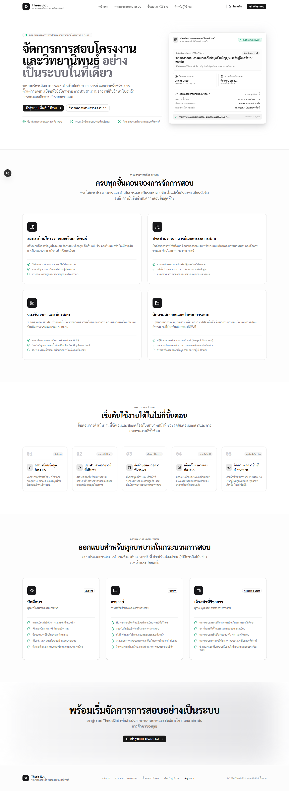
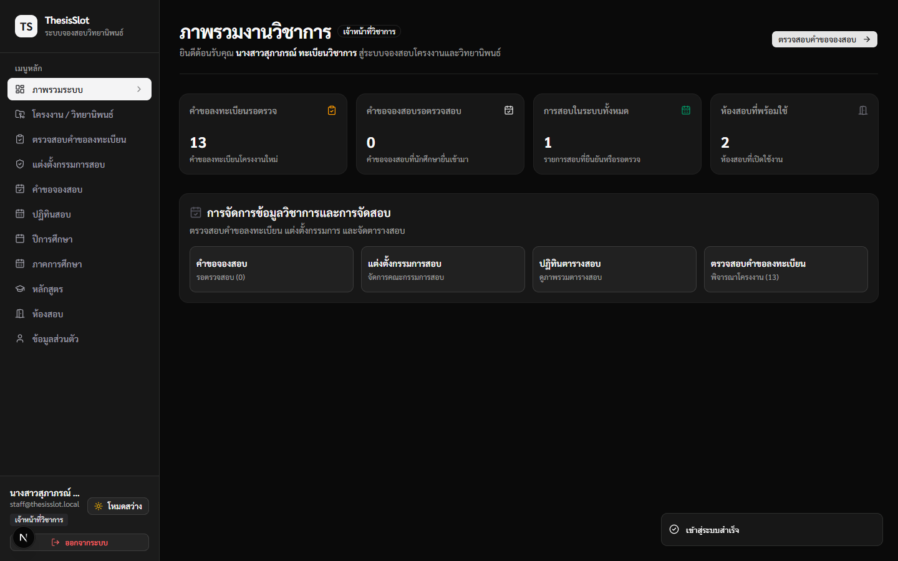
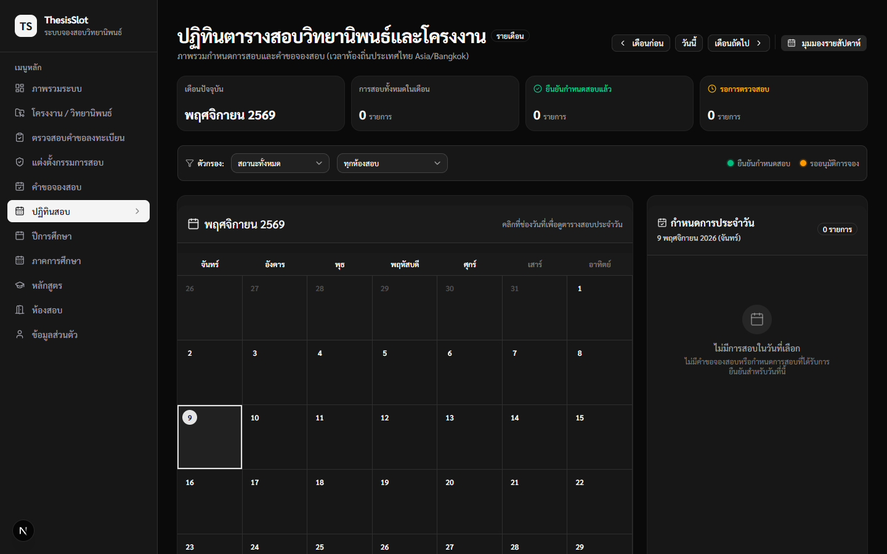
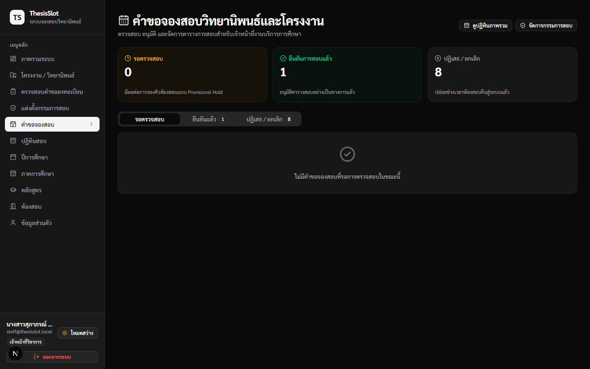
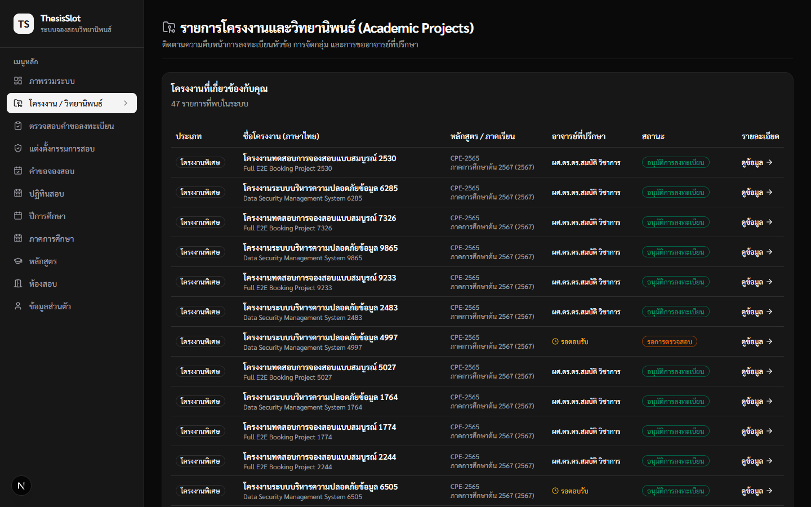
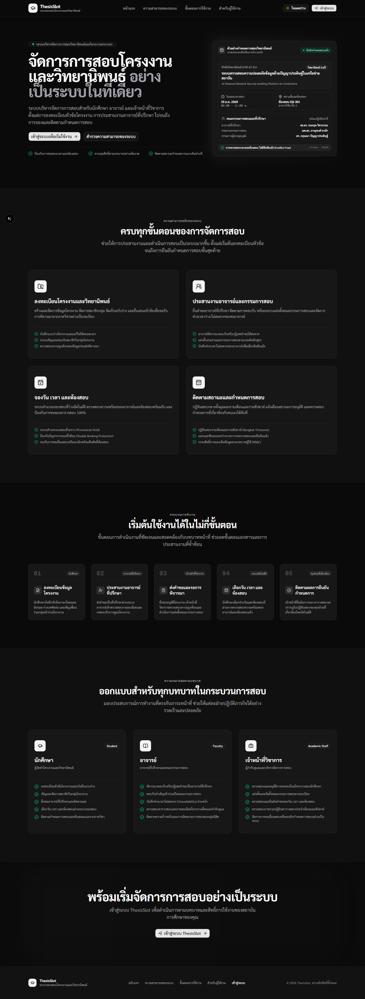
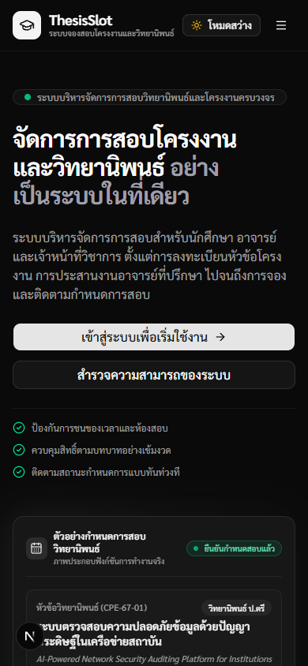

# ThesisSlot

> **ระบบจองสอบโครงงานและวิทยานิพนธ์ (Academic Project & Thesis Examination Booking Platform)**  
> แพลตฟอร์มบริหารจัดการการสอบโครงงานและวิทยานิพนธ์ระดับสถาบันการศึกษา รองรับการลงทะเบียนหัวข้อโครงงาน การประสานงานอาจารย์ที่ปรึกษา การจัดตั้งคณะกรรมการสอบ การจองวัน เวลา และห้องสอบแบบไร้ข้อขัดแย้ง (Conflict-Free Concurrency) ตลอดจนปฏิทินตารางสอบส่วนกลางแบบเรียลไทม์

---

## 1. ภาพรวมระบบ (Project Showcase)

### หน้าแรกของระบบ (Modern Academic Landing Page)



### การเปรียบเทียบมุมมองหน้าจอหลัก (Key Interfaces Showcase)

|         ภาพรวมระบบ (Role-Based Dashboard)          |           ปฏิทินตารางสอบ (Monthly Examination Calendar)            |
| :------------------------------------------------: | :----------------------------------------------------------------: |
|        |  |
| _แดชบอร์ดเฉพาะบทบาทสำหรับติดตามสถิติและภารกิจด่วน_ | _ปฏิทินตารางสอบประจำเดือน (Asia/Bangkok) พร้อมรายละเอียดประจำวัน_  |

|        การตรวจสอบคำขอจองสอบ (Examination Booking Review)         |         การจัดการโครงงาน (Project & Thesis Management)         |
| :--------------------------------------------------------------: | :------------------------------------------------------------: |
|  |  |
|    _เจ้าหน้าที่วิชาการตรวจสอบและอนุมัติการจองสอบพร้อมประวัติ_    |    _ภาพรวมการลงทะเบียนโครงงาน สถานะการตรวจ และสมาชิกกลุ่ม_     |

|               โหมดมืดระดับพรีเมียม (Genuine Dark Mode)               |  ประสบการณ์บนมือถือ (Responsive Mobile Experience)   |
| :------------------------------------------------------------------: | :--------------------------------------------------: |
|  |     |
|      _ดีไซน์ Authentic shadcn/ui Zinc ในโหมดมืด สบายตาและคมชัด_      | _รองรับการแสดงผลทุกหน้าจออย่างสมบูรณ์แบบบนสมาร์ตโฟน_ |

---

## 2. ความสามารถหลักของระบบ (Key Features)

- **ระบบยืนยันตัวตนและการควบคุมสิทธิ์ (Better Auth & RBAC):** ควบคุมสิทธิ์การเข้าถึงข้อมูลตามบทบาท (ADMIN, ACADEMIC_STAFF, FACULTY, STUDENT) อย่างเข้มงวดทั้งในส่วนหน้าบ้านและ Server Actions
- **ข้อมูลหลักทางวิชาการ (Academic Master Data):** บริหารจัดการปีการศึกษา, ภาคการศึกษา, หลักสูตร, และห้องสอบที่พร้อมใช้งาน
- **การลงทะเบียนโครงงานและกลุ่มนิสิต (Project Registration & Groups):** นักศึกษาสามารถร่างโครงงาน เชิญและตอบรับเพื่อนร่วมกลุ่ม และยื่นขออนุมัติโครงงาน
- **การประสานงานอาจารย์ที่ปรึกษา (Advisor Management):** ยื่นคำขออาจารย์ที่ปรึกษา และระบบอาจารย์พิจารณาตอบรับหรือปฏิเสธคำขอ
- **การจัดตั้งคณะกรรมการสอบ (Examination Committee):** เจ้าหน้าที่วิชาการแต่งตั้งประธานและกรรมการสอบ พร้อมระบบตอบรับคำเชิญของอาจารย์
- **การจัดการเวลาว่าง/ไม่สะดวกของอาจารย์ (Faculty Availability):** บันทึกช่วงเวลาที่ไม่สะดวกของอาจารย์เพื่อนำไปคำนวณและตัดรอบสอบที่ขัดแย้งออกโดยอัตโนมัติ
- **ระบบคำนวณรอบสอบและป้องกันการจองซ้ำ (Concurrency-Safe Booking Engine):**
  - คำนวณรอบสอบที่ว่างตามระยะเวลาสอบ (Slot Calculator)
  - กลไกสำรองที่นั่งชั่วคราว (Provisional Hold)
  - ระบบป้องกันการจองชนกันทั้งในส่วนห้องสอบและอาจารย์ (Multi-Resource Lock ด้วย MySQL `GET_LOCK` & Row-level Locking)
  - ผ่านการทดสอบ Concurrency Stress Tests (32 iterations / 64 requests และ 30 multi-resource races พร้อมกัน)
- **ปฏิทินตารางสอบส่วนกลาง (Examination Calendar):**
  - มุมมองรายเดือน (`/examination-calendar`) พร้อมแผงรายละเอียดประจำวันที่เลือก และตัวกรองสถานะ/ห้องสอบ
  - มุมมองรายสัปดาห์ (`/academic/examination-calendar`) แยกตามห้องสอบ
  - คำนวณเวลาท้องถิ่นประเทศไทย `Asia/Bangkok` (UTC+7) แม่นยำ 100%
- **การพิจารณา เลื่อน และยกเลิกการสอบ (Review, Reschedule & Cancellation):** รองรับการอนุมัติคำขอ, การขอเลื่อนวันเวลาสอบแบบ Atomic, และการยกเลิกพร้อมคืนทรัพยากรห้องสอบสู่ระบบทันที

---

## 3. บทบาทผู้ใช้งานในระบบ (User Roles)

| บทบาท                                   | หน้าที่และความรับผิดชอบหลัก                                                                                                             |
| :-------------------------------------- | :-------------------------------------------------------------------------------------------------------------------------------------- |
| **STUDENT (นักศึกษา)**                  | ลงทะเบียนโครงงาน/วิทยานิพนธ์, จัดการสมาชิกในกลุ่ม, ส่งคำขออาจารย์ที่ปรึกษา, ยื่นคำขอจองสอบตามรอบที่ว่าง, และติดตามกำหนดการสอบของตนเอง   |
| **FACULTY (อาจารย์)**                   | พิจารณาตอบรับการเป็นอาจารย์ที่ปรึกษา, ตอบรับคำเชิญเป็นกรรมการสอบ, บันทึกช่วงเวลาที่ไม่สะดวก, และตรวจสอบตารางสอบโครงงานที่ตนเองกำกับดูแล |
| **ACADEMIC_STAFF (เจ้าหน้าที่วิชาการ)** | ตรวจสอบคำขอลงทะเบียนโครงงาน, แต่งตั้งคณะกรรมการสอบ, ตรวจสอบและยืนยันคำขอจองสอบ, จัดการการเลื่อนสอบ/ยกเลิก, และกำกับดูแลห้องสอบ          |
| **ADMIN (ผู้ดูแลระบบ)**                 | บริหารจัดการผู้ใช้งานในระบบ (กำหนดบทบาท, ระงับการใช้งาน), กำกับดูแลข้อมูลหลักทางวิชาการ, และดูแลความเรียบร้อยของระบบทั้งหมด             |

---

## 4. สถาปัตยกรรมและเทคโนโลยี (Technology Stack)

- **Framework:** [Next.js](https://nextjs.org/) 16.4.5 (App Router, Server Components & Server Actions, Turbopack)
- **Core Library:** [React](https://react.dev/) 19.3.0
- **Programming Language:** [TypeScript](https://www.typescriptlang.org/) 5
- **Styling & UI:** [Tailwind CSS](https://tailwindcss.com/) 4 + [shadcn/ui](https://ui.shadcn.com/) (Authentic Zinc Theme, Sarabun Typography)
- **Icons:** [Lucide React](https://lucide.dev/) 1.70.0
- **Authentication:** [Better Auth](https://www.better-auth.com/) 1.7.18
- **ORM & Database Client:** [Prisma](https://www.prisma.io/) 7.10.1 (`@prisma/client`, `@prisma/adapter-mariadb`, `mariadb` 3.5.5)
- **Database Engine:** MySQL 9.7.4 (บน Docker Container `mysql-server`)
- **Date Handling:** `date-fns` 4.4.0 + `date-fns-tz` 3.2.0 (`Asia/Bangkok`)
- **Validation:** `zod` 4.6.7 + `react-hook-form` 7.91.0
- **Testing:**
  - [Vitest](https://vitest.dev/) 5.1.0 + `@testing-library/react` (Unit & High-Concurrency Database Tests)
  - [Playwright](https://playwright.dev/) 1.65.0 (Full Browser E2E Tests & Responsive Snapshots)
  - [agent-browser](https://github.com/vercel-labs/agent-browser) (Vercel Labs Autonomous Browser CLI)
- **Package Manager:** `pnpm` 11.18.0

---

## 5. แผนผังสถาปัตยกรรมระบบ (System Architecture)

```
┌────────────────────────────────────────────────────────────────────────┐
│                        Next.js 16.4 App Router                         │
│  ┌───────────────────────┐  ┌────────────────────────────────────────┐ │
│  │   Public Routes (/)   │  │        Protected Routes (RBAC)         │ │
│  │  - Academic Landing   │  │  - Dashboard    - Projects             │ │
│  │  - Login (/login)     │  │  - Calendar     - Booking Engine       │ │
│  └───────────────────────┘  └────────────────────────────────────────┘ │
└────────────────────────────────────┬───────────────────────────────────┘
                                     │
           ┌─────────────────────────┴─────────────────────────┐
           ▼                                                   ▼
┌─────────────────────────┐                         ┌────────────────────┐
│ Better Auth 1.7         │                         │ Server Actions     │
│ - Session Guards        │                         │ - Project Actions  │
│ - Role Permissions      │                         │ - Booking Actions  │
└─────────────────────────┘                         └─────────┬──────────┘
                                                              │
                                      ┌───────────────────────┴──────────┐
                                      ▼                                  ▼
                        ┌──────────────────────────┐    ┌────────────────────────┐
                        │ Concurrency Controller   │    │ Prisma ORM 7           │
                        │ - Row-level Locking      │───▶│ - Type-safe Client     │
                        │ - Conflict Detector      │    │ - Driver Adapter       │
                        └──────────────────────────┘    └──────────┬─────────────┘
                                                                   │
                                                                   ▼
                                                 ┌───────────────────────────────┐
                                                 │ MySQL 9 Docker Server         │
                                                 │ - thesis_slot_dev (Dev DB)    │
                                                 │ - thesis_slot_test (Test DB)  │
                                                 └───────────────────────────────┘
```

---

## 6. การเริ่มต้นใช้งาน (Getting Started)

### ความต้องการของระบบ (Prerequisites)

- [Node.js](https://nodejs.org/) version 20 หรือสูงกว่า
- [pnpm](https://pnpm.io/) version 9 หรือสูงกว่า (`corepack enable pnpm`)
- [Docker Desktop](https://www.docker.com/) (สำหรับเรียกใช้งาน MySQL Container)

### ขั้นตอนการติดตั้ง (Installation)

1. **โคลนคลังโค้ด:**

   ```bash
   git clone https://github.com/Erbiyon/Thesis-slot.git
   cd thesis-slot
   ```

2. **ติดตั้ง Dependencies ด้วย pnpm:**

   ```bash
   pnpm install
   ```

3. **ตั้งค่า Environment Variables:**
   คัดลอกไฟล์ตัวอย่างและตรวจสอบการเชื่อมต่อฐานข้อมูล:

   ```bash
   cp .env.example .env.local
   ```

   _หมายเหตุ: โครงการแยกฐานข้อมูลอย่างเด็ดขาดระหว่าง Development (`thesis_slot_dev`) ใน `.env.local` และ Testing (`thesis_slot_test`) ใน `.env.test` เพื่อความปลอดภัย_

4. **ตรวจสอบและอัปเดต Schema ของฐานข้อมูล:**

   ```bash
   pnpm db:validate
   pnpm db:status
   ```

5. **รัน Development Server:**
   ```bash
   pnpm dev
   ```
   เปิดเบราว์เซอร์ที่ [http://localhost:3000](http://localhost:3000)

---

## 7. คำสั่งการพัฒนาและชุดทดสอบ (Development & Testing Scripts)

| คำสั่ง              | คำอธิบายการทำงาน                                                                |
| :------------------ | :------------------------------------------------------------------------------ |
| `pnpm dev`          | รัน Next.js Development Server พร้อม Turbopack บนพอร์ต 3000                     |
| `pnpm build`        | คอมไพล์โปรเจกต์ระดับ Production Build ด้วย Next.js และ Turbopack                |
| `pnpm start`        | รันเซิร์ฟเวอร์หลังจากการ Build สำหรับทดสอบสภาพแวดล้อม Production                |
| `pnpm typecheck`    | ตรวจสอบ Type ของ TypeScript ทั้งหมด (`tsc --noEmit`)                            |
| `pnpm lint`         | ตรวจสอบคุณภาพโค้ดด้วย ESLint 9                                                  |
| `pnpm format:check` | ตรวจสอบการจัดรูปแบบโค้ดด้วย Prettier                                            |
| `pnpm format`       | จัดรูปแบบโค้ดทั้งหมดด้วย Prettier อัตโนมัติ                                     |
| `pnpm test:run`     | รันชุดทดสอบ Vitest ทั้งหมด (รวม Concurrency Stress Tests) บน `thesis_slot_test` |
| `pnpm test:e2e`     | รันชุดทดสอบ Playwright ครบทั้ง 8 Suites บนเบราว์เซอร์จริง                       |
| `pnpm db:validate`  | ตรวจสอบความถูกต้องของ `prisma/schema.prisma`                                    |
| `pnpm db:status`    | ตรวจสอบสถานะของ Prisma Migrations                                               |

---

## 8. สถานะโครงการ (Project Status)

| ส่วนประกอบ                                     |    สถานะการพัฒนา     | รายละเอียดความพร้อม                                                           |
| :--------------------------------------------- | :------------------: | :---------------------------------------------------------------------------- |
| **Phase 1: Auth & Academic Foundation**        | ✅ **เสร็จสมบูรณ์**  | Better Auth, RBAC, Academic Master Data CRUD, Role-based Dashboard            |
| **Phase 2: Project & Advisor Management**      | ✅ **เสร็จสมบูรณ์**  | ลงทะเบียนโครงงาน, จัดการสมาชิกกลุ่ม, ส่งคำขอและตอบรับที่ปรึกษา, ตรวจสอบคำขอ   |
| **Phase 3: Booking Engine & Concurrency**      | ✅ **เสร็จสมบูรณ์**  | คำนวณรอบสอบ, ป้องกัน Double Booking, ล็อคทรัพยากรแบบ Concurrency-safe         |
| **Phase 4: Workflow Hardening & E2E**          | ✅ **เสร็จสมบูรณ์**  | อนุมัติการจอง, เลื่อนสอบ, ยกเลิกและคืนสิทธิ์, ทดสอบ End-to-End ครบวงจร        |
| **Enhancement: Monthly Examination Calendar**  | ✅ **เสร็จสมบูรณ์**  | ปฏิทินสอบรายเดือน (`/examination-calendar`) พร้อมแผงรายละเอียดประจำวัน        |
| **Enhancement: Premium Academic Landing Page** | ✅ **เสร็จสมบูรณ์**  | หน้าแรกระดับพรีเมียม (`/`) ออกแบบสำหรับนักศึกษา อาจารย์ และเจ้าหน้าที่วิชาการ |
| **Production Hosting Deployment**              | ⏳ **ยังไม่เผยแพร่** | อยู่ระหว่างรอการยืนยันนโยบายของสถาบันการศึกษา (Local & Test Verified)         |

---

## 9. เอกสารอ้างอิงโครงการ (Project Documentation)

- 📘 [คู่มือการเชื่อมต่อฐานข้อมูล Docker MySQL](docs/DOCKER_MYSQL_DEVELOPMENT.md)
- 📗 [เอกสารรายงานระบบปฏิทินสอบส่วนกลาง (Final Examination Calendar)](docs/FINAL_EXAMINATION_CALENDAR.md)
- 📙 [คู่มือการตั้งค่าโครงการเริ่มต้น (Project Setup)](docs/PROJECT_SETUP.md)
- 📑 [รายงานสรุปผลการพัฒนา Phase 1 — Authentication & Academic Foundation](docs/phases/PHASE_1_AUTH_ACADEMIC_FOUNDATION.md)
- 📑 [รายงานสรุปผลการพัฒนา Phase 2 — Project Registration & Advisors](docs/phases/PHASE_2_PROJECT_REGISTRATION_ADVISORS.md)
- 📑 [รายงานสรุปผลการพัฒนา Phase 3 — Examination Booking Engine](docs/phases/PHASE_3_EXAMINATION_BOOKING_ENGINE.md)
- 📑 [รายงานสรุปผลการพัฒนา Phase 4 — Final Booking Integration & Hardening](docs/phases/PHASE_4_FINAL_BOOKING_INTEGRATION.md)

---

## 10. ลิขสิทธิ์และการจัดทำ (Credits & License)

- **ผู้พัฒนาและดูแลโครงการ:** ทีมวิศวกรรม ThesisSlot
- **เทคโนโลยีและเครื่องมือแคปเจอร์ภาพหน้าจอ:** บันทึกจากแอปพลิเคชันที่ทำงานจริงบนสภาพแวดล้อม Localhost ด้วย [Vercel Labs agent-browser](https://github.com/vercel-labs/agent-browser) และ Playwright
- **ลิขสิทธิ์:** สงวนลิขสิทธิ์ทั้งหมด © 2026 ThesisSlot
