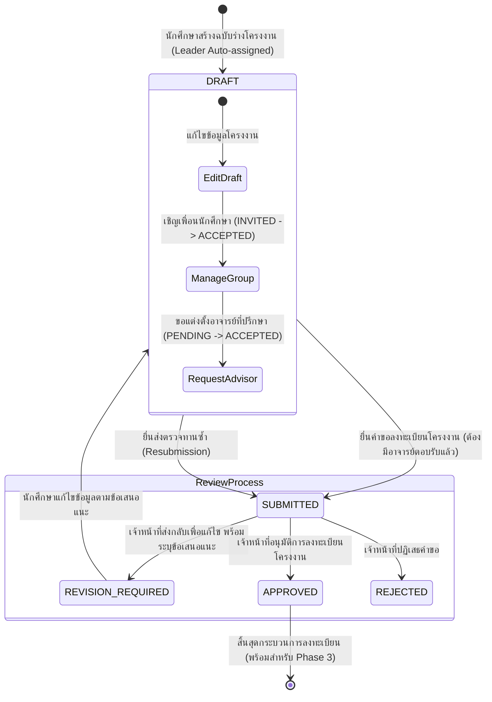

# Phase 2: การลงทะเบียนโครงงาน, การจัดการกลุ่มนักศึกษา และการขออาจารย์ที่ปรึกษา

(Project Registration, Student Groups & Advisor Management)

เอกสารฉบับนี้สรุปผลการพัฒนาระบบใน **Phase 2** ของโครงการ **ThesisSlot (ระบบจองสอบโครงงานและวิทยานิพนธ์)** เพื่อเชื่อมโยงกระบวนการยื่นคำขอโครงงานทางวิชาการระหว่าง นักศึกษา อาจารย์ และเจ้าหน้าที่วิชาการอย่างครบวงจร

---

## 1. วัตถุประสงค์และการส่งมอบงานใน Phase 2

1. **Student Project Draft & Submission:** นักศึกษาสามารถสร้างฉบับร่างโครงงาน/วิทยานิพนธ์ (`PROJECT` หรือ `THESIS`), แก้ไขข้อมูล และยื่นขออนุมัติการลงทะเบียนโครงงาน
2. **Student Group Management:** นักศึกษาสามารถเชิญเพื่อนร่วมกลุ่มผ่านรหัสนักศึกษา ป้องกันการเชิญซ้ำ พร้อมระบบตอบรับหรือปฏิเสธคำเชิญ
3. **Faculty Advisor Request Lifecycle:** นักศึกษาสามารถส่งคำขอแต่งตั้งอาจารย์ที่ปรึกษา โดยอาจารย์สามารถตรวจสอบรายการคำขอและตอบรับ/ปฏิเสธพร้อมบันทึกเหตุผล
4. **Academic Staff Review Workspace:** เจ้าหน้าที่วิชาการสามารถตรวจทานข้อมูลโครงงาน ตรวจสอบอาจารย์ที่ปรึกษาที่ตอบรับ และทำการอนุมัติ (`APPROVED`), ส่งกลับแก้ไข (`REVISION_REQUIRED`) หรือปฏิเสธ (`REJECTED`)
5. **Resubmission Flow:** เมื่อโครงการถูกส่งกลับเพื่อแก้ไข นักศึกษาจะสามารถปรับปรุงเนื้อหาและยื่นส่งตรวจทานซ้ำได้
6. **Role-Based Metrics Integration:** อัปเดตแดชบอร์ดตามบทบาทจริง ไม่ใช้ข้อมูลจำลอง (แสดงจำนวนโครงงานของตนเอง, จำนวนคำขอที่ต้องตอบรับ, จำนวนโครงงานที่รอการตรวจสอบ และรายการที่ต้องแก้ไข)

---

## 2. ตารางการนำทักษะ (Skill Utilization Table) มาประยุกต์ใช้จริง

| ทักษะที่นำมาใช้ (Skill)           | การประยุกต์ใช้ในโครงการ ThesisSlot Phase 2                                                                                                                       | ผลลัพธ์เชิงคุณภาพ                                                                     |
| :-------------------------------- | :--------------------------------------------------------------------------------------------------------------------------------------------------------------- | :------------------------------------------------------------------------------------ |
| **`ui-ux-pro-max`**               | ออกแบบ UI ด้วยธีม **Authentic shadcn/ui Zinc Theme** ภาษาไทยทางการ มี Hierarchy ชัดเจน, ออกแบบ Badge สีบอกสถานะอย่างกลมกลืน (เขียวมรกต, ส้มอำพัน, แดงกุหลาบ)     | ใช้งานง่าย ไม่สับสน รองรับผู้ใช้ทุกระดับทั้งนักศึกษา อาจารย์ และเจ้าหน้าที่           |
| **`vercel-react-best-practices`** | แยก Server Components สำหรับดึงข้อมูล และใช้ `Promise.all` ขนานกันแบบ Parallel Fetching ป้องกัน Request Waterfall; ใช้ Server Actions สำหรับการ Mutation ทั้งหมด | โค้ดมีโครงสร้างสะอาด ประสิทธิภาพสูง ไม่บล็อกการเรนเดอร์ของ Layout                     |
| **`web-animation-design`**        | นำเข้าคลาสแอนิเมชัน `animate-in fade-in-50 duration-300` บน Card และ Page Container พร้อม Micro-interactions บนปุ่มกด                                            | UI มีความนุ่มนวล ทันสมัย และตอบสนองต่อผู้ใช้งานอย่างเป็นธรรมชาติ                      |
| **`web-design-guidelines`**       | ตรวจสอบ Contrast Ratio, Semantic HTML (`<main>`, `<header>`, `<table>`, `<dialog>`), Aria Labels, Form Labels เชื่อมโยงกับ Inputs และ Mobile Drawer Navigation   | ผ่านมาตรฐานการเข้าถึง (Accessibility) และรองรับ Responsive ตั้งแต่ Mobile ถึง Desktop |

---

## 3. สถาปัตยกรรมโมเดลข้อมูล (Prisma 7 Schema Expansion)

บันทึกประวัติการ Migrate ใน `prisma/migrations/20261109091005_phase_2_project_registration_and_advisors`:

### โมเดลและ Enums ที่เพิ่มขึ้น

- **Enums:**
  - `ProjectType`: `PROJECT` (โครงงานพิเศษ), `THESIS` (วิทยานิพนธ์)
  - `ProjectReviewStatus`: `DRAFT`, `SUBMITTED`, `REVISION_REQUIRED`, `APPROVED`, `REJECTED`, `ARCHIVED`
  - `MemberRole`: `LEADER` (หัวหน้ากลุ่ม), `MEMBER` (สมาชิก)
  - `MembershipStatus`: `INVITED`, `ACCEPTED`, `DECLINED`, `CANCELLED`
  - `AdvisorRequestStatus`: `PENDING`, `ACCEPTED`, `DECLINED`, `CANCELLED`
- **Models:**
  - `AcademicProject`: บันทึกข้อมูลโครงงาน, สังกัดหลักสูตร, ภาคเรียน, ผู้สร้าง และสถานะการพิจารณา
  - `ProjectMember`: บันทึกสมาชิกในกลุ่ม, ความสัมพันธ์กับ `StudentProfile`, บทบาท และสถานะคำเชิญ
  - `AdvisorRequest`: บันทึกคำขอเป็นที่ปรึกษา, ความสัมพันธ์กับ `FacultyProfile`, สถานะคำขอ และเหตุผลตอบรับ/ปฏิเสธ
  - `ProjectReview`: บันทึกประวัติการตรวจทานของเจ้าหน้าที่วิชาการ, ผลการพิจารณา และข้อคิดเห็น
  - `ProjectActivity`: บันทึก Activity Log สำหรับ Audit Trail ของโครงงาน

---

## 4. แผนผังวงจรสถานะการทำงาน (Workflow State Machine)

---

## 5. เส้นทางหน้าจอที่พัฒนาใน Phase 2 (Application Routes)

- `/projects`: หน้ารายการโครงงาน (แสดงเฉพาะโครงงานที่ตนเองเป็นสมาชิก/ที่ปรึกษา หรือแสดงทั้งหมดสำหรับเจ้าหน้าที่/ผู้ดูแล)
- `/projects/new`: หน้าสร้างฉบับร่างโครงงานใหม่
- `/projects/[id]`: หน้ารายละเอียดโครงงาน แสดงสมาชิก, อาจารย์ที่ปรึกษา, ไทม์ไลน์ประวัติ และผลการพิจารณา
- `/projects/[id]/edit`: หน้าแก้ไขข้อมูลฉบับร่าง (เฉพาะหัวหน้ากลุ่ม)
- `/projects/[id]/members`: หน้าจัดการสมาชิกกลุ่มโครงงาน (เชิญเพื่อน/ตอบรับ/ปฏิเสธ)
- `/projects/[id]/advisor`: หน้าขอแต่งตั้งอาจารย์ที่ปรึกษา
- `/faculty/advisor-requests`: หน้าพิจารณาคำขออาจารย์ที่ปรึกษาสำหรับคณาจารย์
- `/academic/project-reviews`: หน้ารายการคำขอลงทะเบียนโครงงานที่รอการตรวจสอบ
- `/academic/project-reviews/[id]`: หน้าพิจารณาผลและบันทึกคำแนะนำของเจ้าหน้าที่วิชาการ

---

## 6. ผลการตรวจสอบทางเทคนิคและชุดการทดสอบอัตโนมัติ

| รายการตรวจสอบ                 | คำสั่งที่ใช้            |       ผลการทดสอบ       | หมายเหตุ                                                                |
| :---------------------------- | :---------------------- | :--------------------: | :---------------------------------------------------------------------- |
| **TypeScript Strict Check**   | `pnpm run typecheck`    |        **PASS**        | 0 errors                                                                |
| **ESLint Check**              | `pnpm run lint`         |        **PASS**        | 0 errors, 0 warnings                                                    |
| **Prettier Formatting**       | `pnpm run format:check` |        **PASS**        | รูปแบบโค้ดตรงตามข้อกำหนดทั้งหมด                                         |
| **Vitest Unit & Integration** | `pnpm run test:run`     | **PASS (17/17 tests)** | ทดสอบ Database constraints, Transactions, Phase 1 & Phase 2 integration |
| **Playwright E2E Suite**      | `pnpm run test:e2e`     |  **PASS (5/5 specs)**  | ทดสอบ Smoke, Phase 1 Regression และ Phase 2 Full Lifecycle E2E          |
| **Next.js Production Build**  | `pnpm run build`        |        **PASS**        | คอมไพล์ Static และ Dynamic routes สมบูรณ์                               |
| **Prisma Migrations Status**  | `prisma migrate status` |        **PASS**        | Schema dev/test เป็นปัจจุบัน ไม่มีความคลาดเคลื่อน                       |

---

## 7. ขอบเขตที่สงวนไว้สำหรับ Phase ถัดไป (Intentionally Deferred)

- การเปิดช่วงเวลาและปฏิทินสำหรับการจองสอบ (Examination Booking Slots)
- การตรวจจับการชนกันของห้องสอบและตารางเวลาของกรรมการสอบ (Schedule Conflict Detection)
- การแต่งตั้งและจัดชุดคณะกรรมการสอบโครงงาน/วิทยานิพนธ์ (Examination Committee Assignment)
- การประเมินผลและการให้คะแนนการสอบ (Defense Evaluation & Grading)
- การเชื่อมต่อระบบส่งอีเมลแจ้งเตือนภายนอก (External Email Delivery Service)
