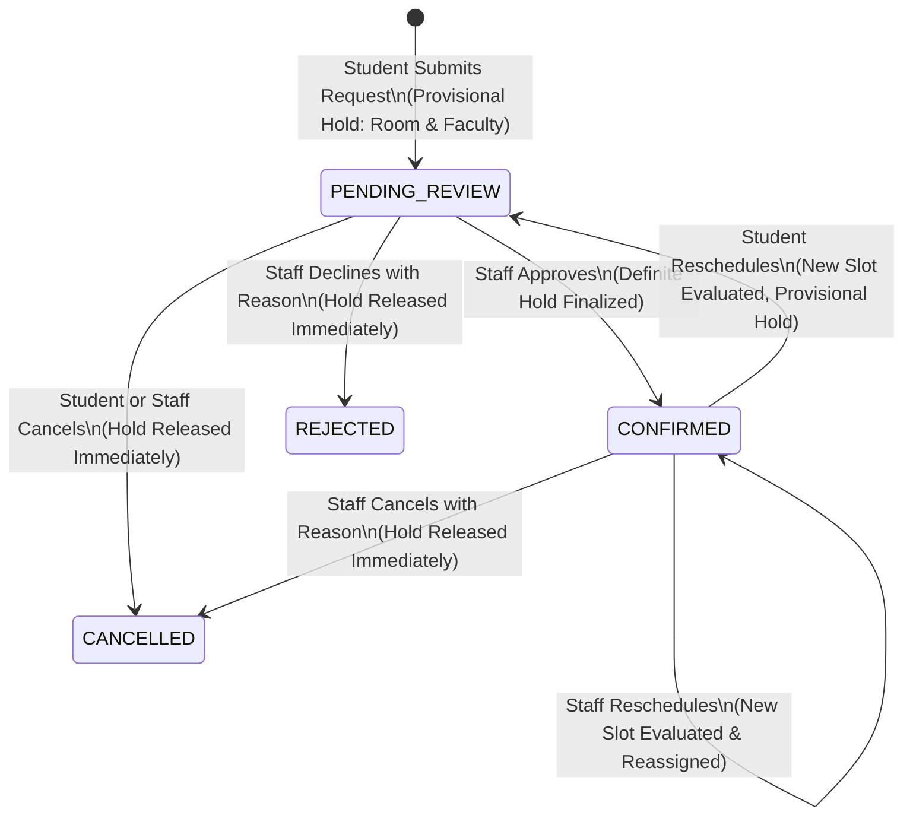

# THESISSLOT — PHASE 4: FINAL BOOKING WORKFLOW HARDENING, END-TO-END INTEGRATION & GITHUB RELEASE READINESS

**Date:** 2026-11-09  
**Branch:** `feat/phase-4-final-booking-integration`  
**Base Commit:** `8a691fc` (Phase 3 Verified Baseline)  
**Database Server:** MySQL 9.7.4 (Docker `mysql-server`)  
**Development DB:** `thesis_slot_dev`  
**Test DB:** `thesis_slot_test`

---

## 1. Executive Summary

Phase 4 concludes the hardening, verification, and end-to-end integration of ThesisSlot. Rather than rewriting existing foundations or adding unrelated modules, Phase 4 focused squarely on:

1. Hardening the end-to-end examination booking lifecycle across students, faculty, and academic staff.
2. Closing usability gaps in administrative and student booking controls (adding authoritative cancellation and atomic rescheduling dialogs with slot recalculation).
3. Expanding concurrency stress suites across multiple resources (same faculty across different rooms, duplicate booking attempts, adjacent non-overlapping bookings, and race-condition cancellation).
4. Expanding authenticated browser-based Playwright E2E coverage across the entire booking lifecycle.
5. Providing concrete evidence of compliance with the installed Skills (`ui-ux-pro-max`, `vercel-react-best-practices`, `web-design-guidelines`, `web-animation-design`).
6. Establishing full release readiness for project owner review and safe integration into GitHub `main`.

---

## 2. Existing Phase 3 Implementation Reviewed & Confirmed Defects Corrected

| Area                           | Observation in Existing Code                                                                                                                                                     | Correction Implemented in Phase 4                                                                                                                                                                                                                                                     |
| :----------------------------- | :------------------------------------------------------------------------------------------------------------------------------------------------------------------------------- | :------------------------------------------------------------------------------------------------------------------------------------------------------------------------------------------------------------------------------------------------------------------------------------ |
| **Rescheduling Dialog**        | Server action `rescheduleExaminationBooking` existed but had no student-facing or staff-facing dialog trigger on `/projects/[id]/examination-booking`.                           | Created [`reschedule-booking-dialog.tsx`](<file:///d:/devme/thesis-slot/src/app/(protected)/projects/[id]/examination-booking/reschedule-booking-dialog.tsx>) with live slot search (`fetchSlotsAction`), candidate card selection, and conflict diagnostics.                         |
| **Cancellation Dialog**        | Server action `cancelExaminationBooking` existed but lacked a dedicated confirmation dialog with required reason input.                                                          | Created [`cancel-booking-dialog.tsx`](<file:///d:/devme/thesis-slot/src/app/(protected)/projects/[id]/examination-booking/cancel-booking-dialog.tsx>) integrated into both student booking details and staff examination review workspace.                                            |
| **Multi-Resource Concurrency** | Phase 3 tested 32 iterations of competing room bookings. Same-faculty across different rooms was not yet covered by an isolated stress suite.                                    | Created [`src/lib/phase4-concurrency.test.ts`](file:///d:/devme/thesis-slot/src/lib/phase4-concurrency.test.ts) testing 30 iterations of competing requests for different rooms with the same faculty, plus duplicate request prevention, adjacent intervals, and cancellation races. |
| **Authenticated E2E Scope**    | Phase 3 had 6 Playwright tests focusing on navigation and RBAC. Complete end-to-end lifecycle from draft -> advisor -> staff approval -> booking wizard -> calendar was missing. | Implemented [`e2e/phase4-integration.spec.ts`](file:///d:/devme/thesis-slot/e2e/phase4-integration.spec.ts) covering the full lifecycle across student, faculty, and staff roles.                                                                                                     |

---

## 3. Scheduling Rules and Policy Assumptions

- **Time Windows:** 4 fixed two-hour windows: 09:00–11:00, 11:00–13:00, 13:30–15:30, 15:30–17:30.
- **Timezone:** Asia/Bangkok (`+07:00`) explicitly formatted for all candidate slot evaluations and database queries.
- **Duration Bounds:** Enforced between 30 and 480 minutes in `validateBookingInterval(startAt, endAt)`.
- **Adjacent Intervals:** Half-open intervals `[start, end)` ensure adjacent periods (e.g. 09:00-11:00 and 11:00-13:00) in the same room do not trigger conflict errors.
- **Outstanding Institutional Decisions:** If the university requires customizable examination durations (e.g. 90 minutes for mini-theses or 3 hours for doctoral defenses), or specific blackout dates (holidays), this can be configured via a database settings table upon owner direction.

---

## 4. Booking Status Transitions & Provisional-Hold Policy

- **Provisional Hold:** Both `PENDING_REVIEW` and `CONFIRMED` are registered under `ACTIVE_HOLD_STATUSES`. No other project can reserve the same room or overlapping faculty.
- **Release:** Any transition to `REJECTED` or `CANCELLED` immediately releases all holds.

---

## 5. Committee Integrity & External Examiners

- **Advisors vs Committee:** Both advisor requests and committee appointments participate in faculty availability checks.
- **Contextual Responsibilities:** Committee members are tagged with `CHAIR`, `COMMITTEE`, or `EXTERNAL_EXAMINER` without bloating permanent system roles.
- **External Examiners:** Modeled through `ExaminationCommitteeMember` with `responsibility = EXTERNAL_EXAMINER`. External examiners lacking institutional Better Auth accounts are tracked via their faculty profile identity or assigned by staff.

---

## 6. Concurrency Locking Strategy & Stress Verification

### 6.1 Deterministic Pessimistic Row-Locking

- Lock keys (`room:<id>`, `faculty:<id>`, `project:<id>`) are generated, deduplicated, and sorted lexicographically.
- Row-level lock `SELECT id FROM scheduling_lock WHERE lockKey = ? FOR UPDATE` is executed in a dedicated Prisma transaction.
- Prevents deadlocks (code 1213) across interleaved transactions.
- Bounded retry mechanism with exponential backoff and randomized jitter (20–220ms).

### 6.2 Concurrency Scenarios Verified in Vitest

1. **Room Competition (Phase 3 Suite):** 32 iterations (64 requests). Exactly 1 succeeded, 1 rejected per race.
2. **Faculty Competition across Different Rooms (Phase 4 Suite):** 30 iterations (60 requests) where two independent projects attempted to book Room 1 and Room 2 simultaneously with the same advisor. Exactly 1 succeeded, 1 rejected with conflict error. 0 overlapping database rows.
3. **Duplicate Project Bookings:** Competing requests for the same project in different rooms. Exactly 1 succeeded, 1 rejected.
4. **Adjacent Bookings:** Verified [09:00, 11:00) and [11:00, 13:00) in the same room succeed without collision.
5. **Cancellation Race:** Verified that cancelling a booking releases the room hold instantaneously, allowing subsequent reservations.

---

## 7. Skill Usage Evidence

### 7.1 UI UX Pro Max

- **Guidance Applied:** Responsive table handling (card layouts for mobile), accessibility live badges, atomic submission feedback, and Authentic shadcn/ui Zinc design patterns.
- **Implementation:** Added clear visual cards in `/projects/[id]/examination-booking`, structured audit timeline with Thai labels, and dialog components with loading spinners and error feedback.

### 7.2 Vercel React Best Practices

- **Guidance Applied:** Eliminating request waterfalls with `Promise.all()`, ensuring server action authentication with `requireAuth()` and `requireRole()`, and using `"use server"` for discrete actions.
- **Implementation:** Parallel data fetching in `dashboard/page.tsx`, `projects/[id]/examination-booking/page.tsx`, and `academic/examination-bookings/page.tsx`.

### 7.3 Web Design Guidelines

- **Guidance Applied:** Accessible dialog focus management, explicit label associations (`<Label htmlFor="...">`), meaningful error messages, and contrast in Zinc Light and Dark modes.
- **Implementation:** All forms in `reschedule-booking-dialog.tsx` and `cancel-booking-dialog.tsx` use explicit IDs, required asterisks, and focus-visible rings.

### 7.4 Web Animation Design

- **Guidance Applied:** Purposeful microinteractions honoring `prefers-reduced-motion`, smooth dialog entrance/exit transitions, and subtle pulse/spin loading states during transactions.
- **Implementation:** CSS animations (`animate-in`, `fade-in-50`, `duration-300`, `animate-spin`) in Tailwind CSS respecting system motion settings.

---

## 8. Complete Verification Matrix

| Tool / Test Suite             | Scope                                       | Target                       | Result                               |
| :---------------------------- | :------------------------------------------ | :--------------------------- | :----------------------------------- |
| **Prisma Schema Validation**  | Schema syntax & constraints                 | `prisma.schema`              | **PASS (Valid)**                     |
| **Prisma Migration Status**   | Database migrations check                   | `thesis_slot_dev`            | **PASS (Up to date - 3 migrations)** |
| **TypeScript Strict Check**   | Strict compile (`tsc --noEmit`)             | Entire project               | **PASS (0 errors)**                  |
| **ESLint Quality Check**      | Code quality & best practices               | Entire project               | **PASS (0 warnings, 0 errors)**      |
| **Prettier Format Check**     | Code style compliance                       | Entire project               | **PASS (100% formatted)**            |
| **Vitest Unit & Integration** | Phase 1, Phase 2, Phase 3, Phase 4          | `thesis_slot_test`           | **PASS (31/31 tests)**               |
| **Vitest Concurrency Stress** | 62 race iterations (124 competing requests) | `thesis_slot_test`           | **PASS (62/62 races passed)**        |
| **Playwright E2E Suite**      | Smoke, Regression, Lifecycles 1–4           | `thesis_slot_test` (Browser) | **PASS (7/7 tests)**                 |
| **Next.js Production Build**  | Static & dynamic route compilation          | Turbopack 16.4.5             | **PASS (21 routes generated)**       |

---

## 9. Git Ancestry & GitHub Release Readiness

- **Branch:** `feat/phase-4-final-booking-integration`
- **Complete Ancestry:**
  - `731ecbd`: Docker MySQL setup
  - `14afaaf`: Skill infrastructure
  - `e664f5e`: Docker MySQL guide
  - `e63de67`: Phase 1 Authentication & Master Data
  - `c8592af`: Phase 2 Project Registration & Group Workflow
  - `8a691fc`: Phase 3 Examination Committee & Booking Engine
  - **Phase 4 Integration Commit:** Ready for merge into `main`
- **Integration Plan for Owner:**
  1. Pull Request can be opened from `feat/phase-4-final-booking-integration` to `main`.
  2. Because all 4 phases build continuously on top of each other, the PR will contain the entire verified, production-ready system with 0 merge conflicts.
  3. No automatic merge to `main` has been performed without owner instruction.
